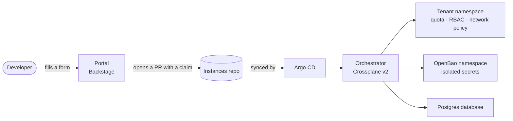

# IdPlatformKit

**A reference Internal Developer Platform, built from open-source building blocks and runnable on your laptop.**

IdPlatformKit shows, end to end, how a platform team can give developers self-service access to secured infrastructure: a team asks for what it needs from a developer portal, and gets an isolated, policy-compliant environment a few minutes later, without opening a ticket.

Everything is designed to be read, run and reused: each design choice is documented, and the whole stack starts locally on [kind](https://kind.sigs.k8s.io/) with no cloud account.

**Website: [idplatformkit.github.io](https://idplatformkit.github.io)**, with the architecture, the design decisions, how to run it, and recorded demos.

## How it fits together

## Repositories

| Repository | Role | Stack |
|---|---|---|
| [**Orchestrator**](https://github.com/idPlatformKit/Orchestrator) | Self-service infrastructure: a library of Crossplane compositions (`Tenant`, `PostgresDatabase`), end-to-end tested on kind | Crossplane v2, OpenBao, provider-sql, kustomize, Argo CD, Gateway API (Envoy Gateway), cert-manager |
| [**portal**](https://github.com/idPlatformKit/portal) | Developer portal: software catalog, GitHub authentication, org and team sync, and the Software Templates. Runs in the cluster | Backstage |
| [**instances-template**](https://github.com/idPlatformKit/instances-template) | The starting point of each installation's instances repository: the claims (`Tenant`, `PostgresDatabase`) that should exist on the platform, validated in CI and synced by Argo CD | YAML, Crossplane CLI |
| [**instances**](https://github.com/idPlatformKit/instances) | The project's own demo installation | YAML |

## Where it stands

- ✅ Multi-tenant namespaces with per-tenant secrets isolation (OpenBao namespaces + Kubernetes auth)
- ✅ Self-service Postgres databases
- ✅ Backstage portal with GitHub sign-in and group import
- ✅ GitOps flow: Argo CD installs the platform and syncs claims from the instances repository
- ✅ Backstage Software Template opening a pull request with a `Tenant` claim, verified end to end: from the form to a provisioned namespace
- ✅ Each tenant's Kubernetes and Crossplane resources visible in the portal
- ✅ Each tenant's OpenBao secrets delivered as Kubernetes Secrets by External Secrets Operator
- ✅ Postgres databases added to a tenant from the portal, linked to it in the catalog, with per-tenant names on the shared server
- ✅ HTTPS on kind: OpenBao and Argo CD on `https://<name>.127.0.0.1.nip.io`, through Gateway API (Envoy Gateway) and cert-manager with a local CA, no port-forwards
- ✅ Installs on your own GitHub org in two commands (`make setup`, `make up`): a guide prepares your org, your instances repository and the portal's sign-in, and the portal runs in the cluster
- 🔜 Single sign-on with Dex, GitHub teams as groups across kubectl, Argo CD, OpenBao and Grafana
- 🔜 Kyverno guardrails, a "new app" golden path, per-tenant observability

Detailed roadmap in the [Orchestrator issues](https://github.com/idPlatformKit/Orchestrator/issues?q=label%3Aroadmap).

## Write-ups

- [Backstage.io Series, Part 1: Getting Started & Setting Up PostgreSQL](https://antoyavin.github.io/writing/backstage-series-part-1-getting-started/)
- [Backstage.io Series, Part 2: GitHub Authentication & User Ingestion](https://antoyavin.github.io/writing/backstage-series-part-2-github-auth/)

More on [Anas Touil's blog](https://antoyavin.github.io/writing/).

## Contributing

Issues, questions and ideas are welcome. Issues labelled [`good first issue`](https://github.com/idPlatformKit/Orchestrator/labels/good%20first%20issue) are a good starting point.

---

Built by [Anas Touil](https://www.linkedin.com/in/anas-touil/), Platform Engineer (CKA, CKAD).
